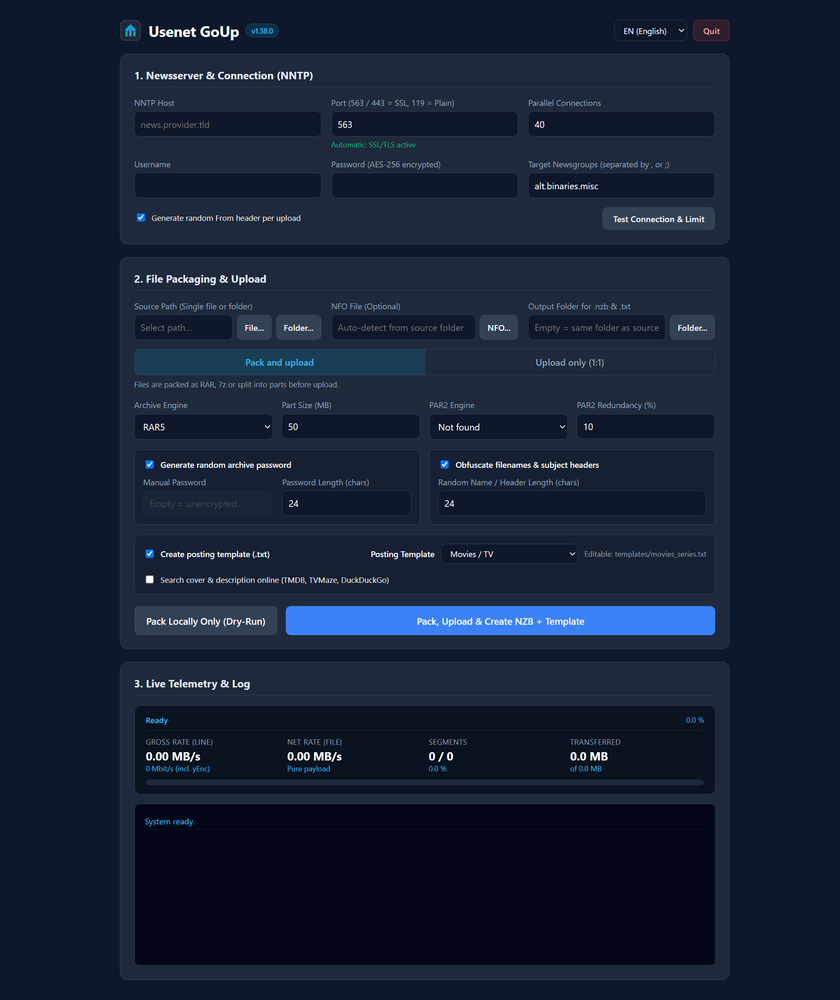

# Usenet GoUp (v1.38.0)

High-Speed Cross-Platform Usenet Uploader in Go (Windows, Linux, macOS).



## Features (v1.38.0)
- **Two Modes: "Pack and upload" or "Upload only (1:1)":** Upload only sends a single file (any extension) or all files directly inside a folder unchanged, without packing or splitting and without copying them. System files (`Thumbs.db`, `desktop.ini`, `.DS_Store`) and symbolic links are skipped; folders with subfolders are rejected with a clear message because an NZB has no folder structure.
- **PAR2:** Always created when packing. In upload-only mode a "Create PAR2 recovery files" switch makes it optional; PAR2 is then written to the work folder, never into your source folder. With PAR2, filenames can be obfuscated (originals stay untouched on disk, PAR2 restores the names on download); without PAR2 only the subject headers are obfuscated.
- **Existing Archive Password (Upload only):** If you already packed and encrypted your archive yourself, enter its password in upload-only mode. It is written into the NZB (`<meta type="password">`, used by SABnzbd / NZBGet to unpack automatically) and into the posting template. It is never saved.
- **Posting Template Optional:** "Create posting template (.txt)" can be switched off. Then only the NZB is written, and MediaInfo and online metadata are skipped as well.
- **Upload Check:** After the upload GoUp asks the server (`STAT`) whether every article arrived and checks missing ones again after 30 seconds. If parts are still missing, the packed files are kept so the upload can be repeated without packing again.
- **Clean Interface:** Source first, then mode; options that do not apply to the chosen mode are hidden instead of greyed out.
- **Templates for Media, Games & Misc:** Dedicated posting templates for `movies_series` (with cover, MediaInfo, metadata) as well as streamlined templates for `games` (PC / Console) and `misc` (E-Book, Software, Audio).
- **Clean BB-Code Spoiler Formatting:** `NFO:` and `MediaInfo:` sections are wrapped in `[SPOILER][NFO]...[/NFO][/SPOILER]` blocks and automatically omitted (including their headings) when empty.
- **Streaming Upload (< 60 MB RAM):** On-demand segmentation via `ReadAt`, no RAM spike on 50+ GB releases.
- **Live Telemetry:** Real-time progress for archiving (RAR5 / 7-Zip / Native Go splitting), PAR2 (ParPar / par2), and NNTP upload.
- **MediaInfo Detection:** Automatically finds the largest media file (`.mkv`, `.mp4`, `.avi`, `.m2ts`, etc.) and reads container metadata natively in Go (MKV, MP4/MOV, AVI) with bounded `mediainfo` / `ffprobe` CLI fallbacks.
- **No Contact with Third Parties by Default:** Apart from the news server, GoUp sends nothing anywhere. There is no telemetry, no update check and no usage statistics. An IMDb ID is taken only from the NFO or the release name.
- **Optional Online Metadata (off by default):** The "Search cover & description online" switch (movies/series template) looks up poster, description and a missing IMDb ID at TMDB (built-in public key), TVMaze and, as a last resort, a DuckDuckGo web search, and inserts them into the posting template. There is no external image upload: a local cover (`cover.jpg`, `poster.jpg`, `folder.jpg`) is only reported in the log and can be uploaded manually if desired.
- **Device & Resource Protection:** Only regular files and folders are accepted as source or output; device paths (`/dev/...`, `\\.\PhysicalDrive0`), pipes and system folders (`/proc`, `/sys`) are rejected. NFO files are read with a 2 MB limit. The archive password is shown in the web interface only, never written to the console log.
- **Local API Security & Hardening:** Loopback-only binding (`127.0.0.1` / `[::1]`), strict `Host` / `Origin` / `Sec-Fetch-Site` CSRF and DNS-rebinding protection, bounded JSON request bodies (`413` on oversized payloads), and AES-encrypted stored secrets.
- **Special Character, Unicode & Long-Path Protection:** Windows Extended-Length (`\\?\\`), XML control character sanitization, and CP437/UTF-8 NFO decoding.
- **Smart Work Directory (Raspberry Pi):** Packages are built in the system temp folder (`TMPDIR` is respected). If it is RAM-based (`tmpfs`, e.g. `/tmp` on Raspberry Pi) or too small, GoUp automatically uses `work/` inside its data folder on disk instead. Leftover work folders from a crash or a killed process are removed at the next start.
- **Crash & Freeze Log (`crash-freeze.log`):** Watchdog, panic stack traces, and browser stall detection.

## Project Structure
| File / Package | Content |
| --- | --- |
| `main.go` | Startup, port check, open browser |
| `app.go` | Server state, routes, configuration, small API handlers |
| `pipeline.go` | Upload job: archive/PAR2 (or cache) -> upload -> NZB -> metadata/template |
| `direct.go` | "Upload only" mode: file collection, optional PAR2, filename obfuscation without renaming |
| `custom_templates.go` | Editable BB-Code templates (`movies_series.txt`, `games.txt`, `misc.txt`) |
| `cache.go` | Package cache (dry run and failed uploads) |
| `security.go` | Local API protection, JSON body size limits and helpers |
| `jobs.go` | Job lock and cancellation |
| `logbroker.go` | Live log and progress via Server-Sent Events (German and English) |
| `i18n.go` | English version of all log and error messages |
| `datadir.go` | Location of `config.json`/`secret.key` (portable, or `~/.config/usenet-goup` for AppImage / read-only installs), disk space requirement |
| `.github/workflows/release.yml`, `.github/release-notes/` | Automated release: on tag push, tests, builds all binaries and AppImages, adds `.sha256` files and creates a release draft (pinned actions, checksum-verified appimagetool) |
| `packaging/linux` | Linux desktop entry and AppStream metadata for the AppImage |
| `build-all.ps1` | Local test builds for all target platforms (official releases are built by GitHub) |
| `internal/config` | Saved settings and shared job parameters |
| `internal/archiver`, `internal/par2` | RAR/7z/native splitting, PAR2 |
| `internal/nntp`, `internal/yenc` | Upload, upload check, NZB, posting template, yEnc |
| `internal/media` | Native container parsers (fuzz-tested), MediaInfo/ffprobe fallback, TMDB/TVMaze metadata |
| `internal/sysproc` | Platform code: paths, dialogs, clipboard, disk space, external tools |
| `internal/crypto` | Encryption of secrets |

Tests: `go test -race ./...`

Toolchain: builds require Go 1.27.4 or newer (`toolchain` in `go.mod`, includes the November 2026 security fixes).

## Build (Windows - Windowless Including App Icon)
```powershell
go build -trimpath -ldflags="-s -w -H=windowsgui -X main.version=v1.38.0" -o usenet-goup.exe .
```

## Build (Linux / macOS)
```bash
go build -trimpath -ldflags="-s -w -X main.version=v1.38.0" -o usenet-goup .
```

## Downloads
Every release on GitHub contains (built automatically by GitHub Actions from the tagged source):

| File | System |
|---|---|
| `Usenet_GoUp-<version>-windows-x86_64.exe` | Windows 64-bit |
| `Usenet_GoUp-<version>-linux-x86_64` | Linux x86_64 |
| `Usenet_GoUp-<version>-linux-aarch64` | Linux ARM64 (e.g. Raspberry Pi with 64-bit OS) |
| `Usenet_GoUp-<version>-macos-x86_64` | macOS Intel |
| `Usenet_GoUp-<version>-macos-arm64` | macOS Apple Silicon |
| `Usenet_GoUp-<version>-x86_64.AppImage` / `-aarch64.AppImage` | Linux AppImage |

Each file has a matching `.sha256` file. Verify on Linux/macOS with `sha256sum -c <file>.sha256`, on Windows with `Get-FileHash <file>` and compare the value.

## Linux AppImage
Each GitHub release includes `Usenet_GoUp-<version>-x86_64.AppImage` and `-aarch64.AppImage` (built automatically by GitHub Actions).
```bash
chmod +x Usenet_GoUp-*.AppImage
./Usenet_GoUp-*.AppImage
```
Settings are stored in `~/.config/usenet-goup`. External tools (`rar`, `7z`, `parpar`/`par2`, `mediainfo`) are not bundled; install them via your package manager.
If the AppImage does not start because FUSE is missing, run it with `--appimage-extract-and-run` or install `libfuse2`.

## Build All Targets (local test builds)
```powershell
.\build-all.ps1
```

## Release Process
1. Set `version` in `main.go` and write `.github/release-notes/<version>.md`.
2. Commit, then `git tag <version>` and `git push origin <version>`.
3. GitHub Actions tests the code, builds all files with `.sha256` and creates a release draft with the notes.
4. Review the draft on GitHub and click "Publish release".

## Dependencies & Licenses
- **Own Source Code:** Released under the **MIT License** (see file `LICENSE`). No warranty; use at your own risk.
- **Go Standard Library:** This project comes without external Go third-party modules (`go.mod` contains only the Go standard library, BSD-3-Clause license).
- **Optional External CLI Tools (Not Included in Source Code):** If installed on the target system, external programs such as `rar` / `7z` (archiving), `parpar` / `par2` (PAR2 creation), `mediainfo` / `ffprobe` (media data), as well as on Linux `zenity` / `kdialog` / `wl-copy` / `xclip` may be called. Their own license terms apply to each of these programs.

## Transparency & Network Connections
- No telemetry, tracking, or update servers are contacted.
- External network connections occur exclusively for:
  1. the configured NNTP server (upload),
  2. only if you switch on "Search cover & description online" (off by default): metadata lookups (TMDB, TVMaze, DuckDuckGo) for cover URL, description and IMDb ID, `movies_series` template only (no image upload).
- Local settings and keys (`config.json`, `secret.key`) as well as logs (`crash-freeze.log`) are created locally at runtime in the application or user directory and are not part of this source archive.
